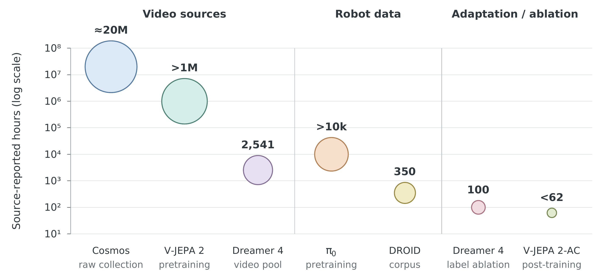
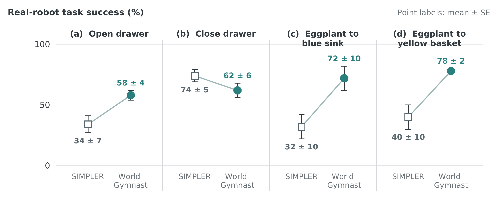

# From Reactive Vision-Language-Action Policies to Predictive World Models: A Review for Robotic Manipulation

Supplementary materials for the review article of the same title (Muhayy Ud Din, Ahsan B. Bakht, Ibrar Yaqoob, and Irfan Hussain; submitted to IEEE Access). The review maps 144 reports on the transition from direct action prediction in vision-language-action (VLA) policies to predictive world models, connects six recurring VLA limitations to candidate world-model mechanisms, and examines whether the reported experiments demonstrate the intended benefit. This repository holds the literature register, screening records, search log, claim-level evidence ledger, companion workbook, and the data and scripts behind the paper's two quantitative figures.

## Contents

- `data/` — literature register (CSV/XLSX), `screening_counts.json`, `search_log.csv`, `evidence_ledger.csv/.json`, `companion_workbook.xlsx`, and the inputs for Figs. 7 and 12.
- `figures/` — Figs. 7 and 12 as PDF, SVG, and PNG.
- `scripts/` — `generate_figure07.py`, `generate_figure12.py`, `build_workbook.py`.
- `docs/evidence_coding_rules.md` — eligibility criteria and label definitions for the evidence ledger.

## Model catalogue

The tables are a reading guide to the policies and predictive systems named in the paper, with links to their primary papers. They are not a ranking and not the included-report count: a row can denote a family, variant, platform component, or method, and predictive policies deliberately appear in both main tables. "VLA" uses the paper's interface criterion of visual observations and language conditioning leading to robot actions; earlier language-conditioned policies are labeled as precursors. Official model cards and technical announcements are labeled as such; their presence does not imply independent evaluation. Datasets (OXE, DROID, BridgeData V2, AgiBot World, RH20T, RoboMIND) appear in the paper's Table 9 rather than here; RT-X is listed as the policy family associated with OXE.

### VLA policies and language-conditioned manipulation policies

| Name | Role | Short description | Primary paper / source |
| --- | --- | --- | --- |
| 3D-CAVLA | VLA policy | Combines depth information, task-relevant visual regions, and intermediate reasoning to adapt VLA policies for manipulation. | [Paper](https://arxiv.org/abs/2505.05800) |
| 3D-VLA (predictive-policy hybrid) | Predictive VLA policy; world-model overlap | Combines 3D visual-language representations with generation of future observations and robot actions, linking spatial grounding with predictive policy learning. | [Paper](https://arxiv.org/abs/2403.09631) |
| Act3D (language-conditioned 3D policy) | Language-conditioned policy / precursor | Uses a hierarchical 3D feature field to predict manipulation actions from visual observations and task instructions. | [Paper](https://arxiv.org/abs/2306.17817) |
| BitVLA | VLA policy | Uses low-bit model weights and a compressed visual encoder to reduce the memory and inference cost of a VLA policy. | [Paper](https://arxiv.org/abs/2506.07530) |
| BridgeVLA | VLA policy | Projects 3D observations into multiple image views and predicts spatial action heatmaps, aligning the policy's input and output representations. | [Paper](https://arxiv.org/abs/2506.07961) |
| CogACT | VLA policy | Conditions a specialized diffusion action transformer on a vision-language backbone to connect semantic interpretation with continuous manipulation actions. | [Paper](https://arxiv.org/abs/2411.19650) |
| Cosmos Policy | Predictive policy; world-model table overlap | Adapts a video model to jointly generate actions, future states and values; evaluates direct policy execution and a separate package for rollout refinement and candidate selection. | [Paper](https://arxiv.org/abs/2601.16163) |
| CoT-VLA (predictive-policy hybrid) | Predictive VLA policy; world-model overlap | Predicts future images as intermediate visual goals before generating action sequences. It combines visual prediction and control without, by itself, establishing candidate-action search. | [Paper](https://arxiv.org/abs/2503.22020) |
| DexVLA | VLA policy | Connects a vision-language backbone to a pretrained diffusion action expert, with staged adaptation across robot embodiments and tasks. | [Paper](https://arxiv.org/abs/2502.05855) |
| Discrete Diffusion VLA | VLA policy | Generates discretized action chunks through iterative diffusion-style refinement within a shared transformer, supporting parallel action decoding. | [Paper](https://arxiv.org/abs/2508.20072) |
| DreamVLA | Predictive policy; world-model table overlap | Forecasts compact dynamic, spatial and semantic representations and conditions diffusion-based action generation on this predicted world knowledge. | [Paper](https://arxiv.org/abs/2507.04447) |
| DreamZero | Predictive policy; world-model table overlap | DreamZero jointly predicts future video and robot actions using a pretrained video-diffusion backbone. It uses this world-action representation for closed-loop control and studies transfer from heterogeneous robot data and video demonstrations. | [Paper](https://arxiv.org/abs/2602.15922) |
| ECoT | VLA policy | Trains a VLA to generate intermediate plans and visually grounded reasoning before predicting robot actions. | [Paper](https://arxiv.org/abs/2407.08693) |
| EdgeVLA / EVLA | VLA policy | Combines a smaller language backbone with non-autoregressive action prediction to reduce deployment cost on resource-constrained robot hardware. | [Paper](https://arxiv.org/abs/2507.14049) |
| FAST / π0-FAST | Action tokenizer and demonstrated policy variant | FAST compresses continuous action chunks into frequency-domain tokens for autoregressive prediction. π0-FAST is a policy variant demonstrating this tokenization approach. | [Paper](https://arxiv.org/abs/2501.09747) |
| FLARE — implicit world modeling | Predictive policy; world-model table overlap | Aligns policy features with embeddings of future observations to incorporate latent prediction into diffusion-based action learning; also supports co-training with action-free video. | [Paper](https://arxiv.org/abs/2505.15659) |
| ForceVLA | VLA policy | Integrates force-torque feedback with visual-language features through a force-aware mixture-of-experts module for contact-rich manipulation. | [Paper](https://arxiv.org/abs/2505.22159) |
| FP3 (language-conditioned 3D policy) | Language-conditioned policy | Pretrains a diffusion-transformer manipulation policy using point clouds, proprioception, and CLIP-encoded instructions, then adapts it to downstream tasks. | [Paper](https://arxiv.org/abs/2503.08950) |
| GE-Act (Genie Envisioner component) | Predictive platform action policy | Uses the Genie Envisioner video representation for instruction-conditioned robot action generation. It is the platform's action-policy component; GE-Sim is its learned-simulator component. | [Paper](https://arxiv.org/abs/2508.05635) |
| Gemini Robotics | VLA policy | A Gemini-based VLA family for language-conditioned robot control across manipulation tasks and embodiments; reported evaluations originate from the model developer. | [Paper](https://arxiv.org/abs/2503.20020) |
| Gemini Robotics 1.5 | VLA policy | A vendor-reported multi-embodiment VLA that integrates reasoning with action generation and supports motion transfer across robot configurations. | [Paper](https://arxiv.org/abs/2510.03342) |
| Gemini Robotics On-Device | VLA policy | A vendor-reported VLA designed to run locally on robot hardware and adapt to manipulation tasks through fine-tuning. | [Official technical source](https://deepmind.google/blog/gemini-robotics-on-device-brings-ai-to-local-robotic-devices/) |
| GeoVLA | VLA policy | Fuses image-language representations with point-cloud geometry in a spatially informed action expert. | [Paper](https://arxiv.org/abs/2508.09071) |
| GR-1 (predictive-policy hybrid) | Predictive VLA policy; world-model overlap | Predicts future images and robot actions from language, image history, and proprioception after video pretraining. Joint prediction is distinct from evaluating supplied candidate actions. | [Paper](https://arxiv.org/abs/2312.13139) |
| GR-2 (predictive-policy hybrid) | Predictive VLA policy; world-model overlap | Uses large-scale video pretraining followed by joint video and action learning for generalist manipulation. | [Paper](https://arxiv.org/abs/2410.06158) |
| GR00T N1 | VLA policy | A generalist humanoid policy that connects vision-language interpretation to diffusion-based action generation. | [Paper](https://arxiv.org/abs/2503.14734) |
| GR00T N1.5 | VLA policy | Extends GR00T N1 with architectural and data changes, including future-latent representation alignment for policy learning. | [Official technical source](https://research.nvidia.com/labs/gear/gr00t-n1_5/) |
| GR00T N1.7 | VLA policy | GR00T N1.7 is a cross-embodiment robot policy that conditions action chunks on visual observations, language, and proprioception. Its released model uses a flow-matching action transformer and supports post-training for particular robots and tasks. | [Official model card; no dedicated paper identified](https://huggingface.co/nvidia/GR00T-N1.7-3B) |
| GraspVLA | VLA policy | Combines autoregressive perception and flow-matching action generation for grasping, using large-scale synthetic robot data alongside semantic pretraining. | [Paper](https://arxiv.org/abs/2505.03233) |
| HarmoWAM | Predictive policy; world-model table overlap | Combines predictive and reactive action experts through adaptive gating to balance generalization and precise control. | [Paper](https://arxiv.org/abs/2605.10942) |
| Helix | VLA policy | A vendor-reported humanoid VLA combining a slower vision-language component with a faster continuous-action controller for upper-body manipulation. | [Official technical source](https://www.figure.ai/news/helix) |
| Helix 02 | VLA and whole-body control system | Helix 02 combines language and scene reasoning, a full-body visuomotor policy, and a learned low-level whole-body controller. The vendor describes coordinated locomotion and manipulation using visual, tactile, and proprioceptive inputs. | [Official technical release; vendor-reported](https://www.figure.ai/news/helix-02) |
| Hi Robot | VLA policy | Uses hierarchical vision-language-action policies to interpret complex instructions and user feedback, then execute the selected manipulation steps. | [Paper](https://arxiv.org/abs/2502.19417) |
| HULC (language-conditioned policy) | Language-conditioned comparator; related context | A hierarchical language-conditioned imitation policy using latent plans and aligned visual-language representations for multi-task manipulation. | [Paper](https://arxiv.org/abs/2204.06252) |
| LAPA | VLA policy | Learns latent actions from video without ground-truth action labels during pretraining, then adapts the latent policy to robot actions using robot data. | [Paper](https://arxiv.org/abs/2410.11758) |
| LaWAM | Predictive policy; world-model table overlap | Predicts latent visual subgoals and conditions action generation on them, using a latent world model to provide foresight without dense pixel generation. | [Paper](https://arxiv.org/abs/2606.15768) |
| LingBot-VLA 2.0 | VLA policy with auxiliary predictive supervision | LingBot-VLA 2.0 extends a generalist VLA with whole-body action spaces and training across multiple robot embodiments and human videos. Auxiliary future prediction uses video-representation and depth-estimation supervision to connect action learning with temporal and geometric information. | [Paper](https://arxiv.org/abs/2607.06403) |
| LLARVA | VLA policy | Uses vision-action instruction tuning and intermediate 2D visual traces to align multimodal representations with robot behavior. | [Paper](https://arxiv.org/abs/2406.11815) |
| LoHoVLA | VLA policy | Jointly generates subtask language and robot-action tokens, using hierarchical feedback to support multi-step manipulation. | [Paper](https://arxiv.org/abs/2506.00411) |
| Long-VLA | VLA policy | Uses phase-aware masking of sensory inputs to improve subtask coordination and long-horizon manipulation. | [Paper](https://arxiv.org/abs/2508.19958) |
| ManiGaussian | Predictive policy; world-model table overlap | Uses dynamic Gaussian representations and future-scene reconstruction as predictive supervision for language-conditioned manipulation; the cited evaluation uses RLBench simulation. | [Paper](https://arxiv.org/abs/2403.08321) |
| MemoryVLA | VLA policy | Combines perceptual and semantic memory retrieval with a memory-conditioned diffusion action expert for temporally dependent manipulation. | [Paper](https://arxiv.org/abs/2508.19236) |
| Octo | VLA policy | An open generalist robot policy with a diffusion action head, supporting language or image goals and adaptation to new observation and action interfaces. | [Paper](https://arxiv.org/abs/2405.12213) |
| OneTwoVLA | VLA policy | Unifies reasoning and action generation, switching between explicit reasoning and execution as the task progresses. | [Paper](https://arxiv.org/abs/2505.11917) |
| OpenVLA | VLA policy | An open VLA that combines pretrained visual-language representations with autoregressive robot-action prediction and task-specific fine-tuning. | [Paper](https://arxiv.org/abs/2406.09246) |
| OpenVLA-OFT | VLA adaptation recipe and resulting policy | An optimized fine-tuning recipe for OpenVLA using action chunking and parallel continuous regression rather than sequential action-token decoding. | [Paper](https://arxiv.org/abs/2502.19645) |
| PerAct (language-conditioned 3D policy) | Language-conditioned policy / precursor | A language-conditioned behavior-cloning policy that uses voxelized observations and a Perceiver architecture for 6-DoF manipulation. | [Paper](https://arxiv.org/abs/2209.05451) |
| π0 | VLA policy | Pairs a pretrained vision-language backbone with a flow-matching action expert for continuous robot control across tasks and embodiments. | [Paper](https://arxiv.org/abs/2410.24164) |
| π0.5 | VLA policy | Extends the π0 approach through heterogeneous co-training and hierarchical task conditioning for manipulation beyond familiar training environments. | [Paper](https://arxiv.org/abs/2504.16054) |
| π0.7 | VLA policy | π0.7 conditions a generalist robot policy on language and additional context such as subgoal images and task-performance metadata. This conditioning supports steering the execution strategy while training on demonstrations, autonomous experience, and non-robot data. | [Paper](https://arxiv.org/abs/2604.15483) |
| PointVLA | VLA policy | Adds point-cloud features to pretrained VLA action modules through lightweight adaptation, improving access to 3D geometry. | [Paper](https://arxiv.org/abs/2503.07511) |
| QueST (language-conditioned skill policy) | Language-conditioned policy | Learns quantized temporal skill representations from action sequences and predicts skills from visual observations and task descriptions for multitask and few-shot control. It provides a lightweight policy baseline for RIPT-VLA. | [Paper](https://arxiv.org/abs/2407.15840) |
| RationalVLA | VLA policy | Couples high-level instruction reasoning with manipulation control and includes rejection of commands judged infeasible or defective. | [Paper](https://arxiv.org/abs/2506.10826) |
| RDT-1B | VLA policy | A diffusion-transformer policy for bimanual manipulation that uses a unified action representation across robot configurations. | [Paper](https://arxiv.org/abs/2410.07864) |
| RoboFlamingo | VLA policy | Adapts a pretrained OpenFlamingo vision-language model to robot imitation learning with an action-prediction interface. | [Paper](https://arxiv.org/abs/2311.01378) |
| RoboMamba | VLA policy | Uses a Mamba state-space backbone to connect multimodal reasoning with efficient manipulation-action prediction. | [Paper](https://arxiv.org/abs/2406.04339) |
| RT-1 (contextual precursor) | Language-conditioned policy / precursor | A transformer policy that maps camera observations and language instructions to discretized robot-control commands. | [Paper](https://arxiv.org/abs/2212.06817) |
| RT-2 | VLA policy | Represents robot actions as tokens and co-trains on robot trajectories and vision-language tasks to transfer semantic knowledge into control. | [Paper](https://arxiv.org/abs/2307.15818) |
| RT-H | VLA policy | Introduces a language-mediated action hierarchy between task instructions and low-level robot commands. | [Paper](https://arxiv.org/abs/2403.01823) |
| RT-X family (RT-1-X / RT-2-X) | VLA policy | Cross-embodiment robot policies trained using the Open X-Embodiment collection. This entry concerns the RT-X models rather than the dataset itself. | [Paper](https://arxiv.org/abs/2310.08864) |
| RVT (language-conditioned 3D policy) | Language-conditioned policy / precursor | Combines rendered multi-view observations and language-goal embeddings in a transformer to predict spatially grounded manipulation actions. | [Paper](https://arxiv.org/abs/2306.14896) |
| RVT-2 | VLA policy | Improves the efficiency and spatial precision of multi-view manipulation policies, emphasizing learning from limited demonstrations. | [Paper](https://arxiv.org/abs/2406.08545) |
| Seer | Predictive VLA policy; world-model overlap | Learns a predictive inverse-dynamics policy that produces robot actions conditioned on forecast visual states. It is pretrained on robot demonstrations and evaluated in simulated and physical manipulation, including robustness and generalization tests. | [Paper (2024)](https://arxiv.org/abs/2412.15109) |
| SmolVLA | VLA policy | A compact VLA with a flow-matching action expert and asynchronous inference intended to support affordable robot training and deployment. | [Paper](https://arxiv.org/abs/2506.01844) |
| SpatialVLA | VLA policy | Uses geometric visual representations and spatial action tokens to improve language-conditioned manipulation. | [Paper](https://arxiv.org/abs/2501.15830) |
| StructVLA | Predictive policy; world-model table overlap | First trains a generative model to predict sparse visual milestones from instructions and observation history. A second stage adapts the model to action-token prediction conditioned on instructions and interleaved observation–action history. | [Paper](https://arxiv.org/abs/2603.12553) |
| Tactile-VLA | VLA policy | Combines tactile feedback and multimodal reasoning with a hybrid position-force controller for physical interaction. | [Paper](https://arxiv.org/abs/2507.09160) |
| Tactile-WAM | Predictive policy; world-model table overlap | Jointly models visual, tactile and action information with tactile asymmetric attention, directing contact information toward action prediction while limiting interference with video generation. | [Paper](https://arxiv.org/abs/2606.26663) |
| TinyVLA | VLA policy | Combines a compact multimodal backbone with a diffusion action decoder for data-efficient manipulation learning. | [Paper](https://arxiv.org/abs/2409.12514) |
| TouchWorld | Predictive policy; world-model table overlap | Combines predicted tactile subgoals and visuomotor action chunks with a faster tactile/proprioceptive correction policy for contact-rich dexterous manipulation. | [Paper](https://arxiv.org/abs/2607.07287) |
| Video Prediction Policy (VPP) | Predictive VLA policy; world-model overlap | Uses representations inside a video diffusion model to condition an implicit inverse-dynamics policy. The video model is adapted with robot and human-manipulation data and evaluated on generalization and dexterous manipulation. | [Paper (2024)](https://arxiv.org/abs/2412.14803) |
| VIMA (contextual multimodal policy) | Language-conditioned policy / precursor | Uses interleaved image and text prompts to specify manipulation tasks, then generates robot actions with a transformer policy. | [Paper](https://arxiv.org/abs/2210.03094) |
| VLA-JEPA | Predictive policy; world-model table overlap | Pretrains a policy backbone to predict future latent states from current observations, then fine-tunes an action head. The future frames provide supervision rather than inputs to the prediction pathway. | [Paper](https://arxiv.org/abs/2602.10098) |
| WorldVLA | Predictive policy; world-model table overlap | Uses shared autoregressive modeling for actions and future observations. Predictive supervision is evaluated as a training component, separately from the question of online candidate-action search. | [Paper](https://arxiv.org/abs/2506.21539) |

### World models and related predictive systems

This table includes latent control models, generative environments, predictive representations, data/evaluation pipelines, and predictive action architectures. An auxiliary future-prediction objective or joint video/action generator does not, by itself, establish a forward-model interface for supplied candidate actions or online search. Game-domain and representation-learning precursors remain explicitly distinguished from physical robot control.

| Name | Role | Short description | Primary paper / source |
| --- | --- | --- | --- |
| 3D-VLA | Predictive action architecture; VLA overlap | Combines a 3D vision-language backbone with generation of goal images or point clouds and robot actions, linking multimodal prediction with manipulation. | [Paper](https://arxiv.org/abs/2403.09631) |
| AVDC | Video prediction / generated environments | Generates task-directed videos and uses dense inter-frame correspondences to infer control actions from action-free demonstrations. | [Paper](https://arxiv.org/abs/2310.08576) |
| Cosmos | Video prediction / generated environments | Provides video tokenization and generative world foundation models for physical-AI development. Specific action-conditioning and robot-control capabilities depend on the chosen model and adaptation. | [Paper](https://arxiv.org/abs/2501.03575) |
| Cosmos Policy | Predictive action architecture; VLA overlap | Adapts a video model to jointly generate actions, future states and values; evaluates direct policy execution and a separate package for rollout refinement and candidate selection. | [Paper](https://arxiv.org/abs/2601.16163) |
| CoT-VLA | Predictive action architecture; VLA overlap | Predicts future visual goals as an intermediate representation before generating action sequences; its visual chain of thought is a predictive policy mechanism. | [Paper](https://arxiv.org/abs/2503.22020) |
| Ctrl-World | Learned simulation / data / evaluation | Combines multi-view video prediction, frame-level action conditioning and pose-conditioned memory retrieval for policy rollouts, evaluation and generation of corrective training data. | [Paper](https://arxiv.org/abs/2510.10125) |
| DINO-WM | Predictive representation / latent planning | Learns action-conditioned transitions over pretrained DINO patch features and plans toward visual goals without reconstructing images. | [Paper](https://arxiv.org/abs/2411.04983) |
| DreamDojo | Action-conditioned video world model | DreamDojo learns an action-conditioned video world model from human videos using continuous latent actions as proxy controls, then adapts it with robot data. Its generated rollouts support applications including policy evaluation and model-based planning. | [Paper](https://arxiv.org/abs/2602.06949) |
| Dreamer (first generation) | Historical / family context | Learns an actor and value function from imagined trajectories in a latent dynamics model, with gradients through predicted states for visual continuous control. | [Paper](https://arxiv.org/abs/1912.01603) |
| Dreamer 4 | Latent dynamics / model-based control | Trains policies inside a scalable video world model using offline data; separate ablations examine action conditioning with partial labels. Its principal demonstration is Minecraft, not physical manipulation. | [Paper](https://arxiv.org/abs/2509.24527) |
| DreamerV2 | Historical / family context | Uses discrete latent dynamics and learns behavior in imagination; its central demonstrations concern Atari. | [Paper](https://arxiv.org/abs/2010.02193) |
| DreamerV3 | Latent dynamics / model-based control | Uses latent imagination with training procedures designed to work across varied control domains using one configuration; a general reinforcement-learning foundation rather than a manipulation-specific VLA. | [Paper](https://arxiv.org/abs/2301.04104) |
| DreamGen | Learned simulation / data / evaluation | Generates task-conditioned robot videos and infers pseudo-actions with inverse dynamics to augment policy-training data; it is an offline data-generation pipeline. | [Paper](https://arxiv.org/abs/2505.12705) |
| DreamVLA | Predictive action architecture; VLA overlap | Forecasts compact dynamic, spatial and semantic representations and conditions diffusion-based action generation on this predicted world knowledge. | [Paper](https://arxiv.org/abs/2507.04447) |
| DreamZero | World-action model and predictive VLA policy | DreamZero jointly predicts future video and robot actions using a pretrained video-diffusion backbone. It uses this world-action representation for closed-loop control and studies transfer from heterogeneous robot data and video demonstrations. | [Paper](https://arxiv.org/abs/2602.15922) |
| FLARE — implicit world modeling | Predictive action architecture; VLA overlap | Aligns policy features with embeddings of future observations to incorporate latent prediction into diffusion-based action learning; also supports co-training with action-free video. | [Paper](https://arxiv.org/abs/2505.15659) |
| GE-Sim — Genie Envisioner component | Learned simulation / data / evaluation | Provides action-conditioned neural simulation for closed-loop policy rollouts within the Genie Envisioner platform; it shares the platform's reference paper. | [Paper](https://arxiv.org/abs/2508.05635) |
| Genie (first generation) | Video prediction / generated environments | Learns latent actions and interactive video dynamics from unlabelled video, allowing generated environments to respond to controls. It is a contextual environment-generation precursor. | [Paper](https://arxiv.org/abs/2402.15391) |
| Genie 2 | Historical / family context | Generates action-controllable 3D visual environments from an image for interactive exploration; included as a predecessor in the Genie family. | [Official research announcement; no paper cited](https://deepmind.google/blog/genie-2-a-large-scale-foundation-world-model/) |
| Genie 3 | Video prediction / generated environments | Generates interactive visual environments that respond to user control; the cited release concerns environment generation rather than validated physical robot dynamics. | [Official research announcement; no paper cited](https://deepmind.google/blog/genie-3-a-new-frontier-for-world-models/) |
| Genie Envisioner | Video prediction / generated environments | Unifies instruction-conditioned video modeling, action generation and learned simulation through GE-Base, GE-Act and GE-Sim; the simulator component is listed separately. | [Paper](https://arxiv.org/abs/2508.05635) |
| GR-1 | Predictive action architecture; VLA overlap | Jointly predicts future images and robot actions from language, visual history and robot state after video pretraining; joint prediction does not itself establish online candidate-action search. | [Paper](https://arxiv.org/abs/2312.13139) |
| GR-2 | Predictive action architecture; VLA overlap | Scales video-language-action pretraining and joint visual/action prediction using web video and robot trajectories for manipulation. | [Paper](https://arxiv.org/abs/2410.06158) |
| GWM — Gaussian World Models | Geometric / physical prediction | Uses action-conditioned dynamics over Gaussian scene representations to predict manipulation outcomes, with applications to predictive pretraining and learned simulation. | [Paper](https://arxiv.org/abs/2508.17600) |
| HarmoWAM | Predictive action architecture; VLA overlap | Combines predictive and reactive action experts through adaptive gating to balance generalization and precise control. | [Paper](https://arxiv.org/abs/2605.10942) |
| I-JEPA — representation precursor | Predictive representation precursor; not an action-conditioned world model | Predicts target image-region embeddings from visible image context without reconstructing pixels. It is an image representation learner, not a temporal action-conditioned robot world model. | [Paper](https://arxiv.org/abs/2301.08243) |
| iVideoGPT | Video prediction / generated environments | Autoregressively models tokenized observations, actions and rewards, supporting interactive video prediction, visual planning and model-based reinforcement learning. | [Paper](https://arxiv.org/abs/2405.15223) |
| LaWAM | Predictive action architecture; VLA overlap | Predicts latent visual subgoals and conditions action generation on them, using a latent world model to provide foresight without dense pixel generation. | [Paper](https://arxiv.org/abs/2606.15768) |
| LingBot-VLA 2.0 | VLA with auxiliary predictive supervision; policy-table overlap | LingBot-VLA 2.0 extends a generalist VLA with whole-body action spaces and training across multiple robot embodiments and human videos. Auxiliary future prediction uses video-representation and depth-estimation supervision to connect action learning with temporal and geometric information. | [Paper](https://arxiv.org/abs/2607.06403) |
| ManiGaussian | Geometric / physical prediction | Uses dynamic Gaussian representations and future-scene reconstruction as predictive supervision for language-conditioned manipulation; the cited evaluation uses RLBench simulation. | [Paper](https://arxiv.org/abs/2403.08321) |
| MuZero | Latent dynamics / model-based control | Learns latent transitions that predict rewards, values and action priors for tree search without reconstructing observations. The cited evidence concerns games. | [Paper](https://arxiv.org/abs/1911.08265) |
| PhysDreamer | Geometric / physical prediction | Distills motion priors from video generation into physical material estimates and interactive 3D dynamics. Its evidence concerns synthesized object responses, not downstream physical robot task success. | [Paper](https://arxiv.org/abs/2404.13026) |
| PlaNet | Latent dynamics / model-based control | Learns action-conditioned recurrent latent dynamics from images and selects action sequences with model-predictive control. | [Paper](https://arxiv.org/abs/1811.04551) |
| Seer | Predictive action architecture; VLA overlap | Learns a predictive inverse-dynamics policy that produces robot actions conditioned on forecast visual states. It is pretrained on robot demonstrations and evaluated in simulated and physical manipulation, including robustness and generalization tests. | [Paper (2024)](https://arxiv.org/abs/2412.15109) |
| Sora — 2024 report | Historical / family context | Uses text-conditioned diffusion over spacetime latent patches to generate video; the report discusses emergent simulation properties and limitations rather than verified robot control. | [Technical report](https://openai.com/index/video-generation-models-as-world-simulators/) |
| StructVLA | Predictive action architecture; VLA overlap | First trains a generative model to predict sparse visual milestones from instructions and observation history. A second stage adapts the model to action-token prediction conditioned on instructions and interleaved observation–action history. | [Paper](https://arxiv.org/abs/2603.12553) |
| SuSIE | Video prediction / generated environments | Fine-tunes an image-editing diffusion model to propose visual subgoals from an observation and instruction; a goal-conditioned controller executes the subgoals. | [Paper](https://arxiv.org/abs/2310.10639) |
| Tactile-WAM | Predictive action architecture; VLA overlap | Jointly models visual, tactile and action information with tactile asymmetric attention, directing contact information toward action prediction while limiting interference with video generation. | [Paper](https://arxiv.org/abs/2606.26663) |
| TD-MPC2 | Latent dynamics / model-based control | Learns task-conditioned latent dynamics and value functions for model-predictive control across continuous-control tasks. | [Paper](https://arxiv.org/abs/2310.16828) |
| TesserAct | Geometric / physical prediction | Predicts RGB, depth and surface-normal video to represent the evolution of 3D scenes over time; the multimodal predictions also support inverse-dynamics learning. | [Paper](https://arxiv.org/abs/2504.20995) |
| TouchWorld | Predictive action architecture; VLA overlap | Combines predicted tactile subgoals and visuomotor action chunks with a faster tactile/proprioceptive correction policy for contact-rich dexterous manipulation. | [Paper](https://arxiv.org/abs/2607.07287) |
| UnifoLM-WMA-0 | Released world-model/action framework | Unitree's released world-model/action framework uses predictive video dynamics for simulation and policy enhancement; the cited artifact is a technical release, not a reference paper. | [Official release; paper not identified](https://github.com/unitreerobotics/unifolm-world-model-action) |
| Unified World Models (UWM) | Coupled video/action diffusion | Couples video and action diffusion in one transformer with separate diffusion timesteps for the modalities. Its conditioning supports policy, forward-dynamics, inverse-dynamics and video-generation modes, including learning from action-free video. | [Paper (2025)](https://arxiv.org/abs/2504.02792) |
| UniPi | Video prediction / generated environments | Generates a language-conditioned video plan and recovers executable actions through inverse dynamics; generated plans are not predictions conditioned on supplied candidate robot actions. | [Paper](https://arxiv.org/abs/2302.00111) |
| UniSim | Video prediction / generated environments | Learns an interactive video simulator that responds to high-level instructions or low-level controls, supporting simulated policy learning and evaluation. | [Paper](https://arxiv.org/abs/2310.06114) |
| V-JEPA 2 — action-free backbone | Predictive representation / latent planning | Scales predictive video representation learning for understanding and anticipation. Robotic action-conditioned planning belongs to the separately adapted 2-AC configuration. | [Paper](https://arxiv.org/abs/2506.09985) |
| V-JEPA 2-AC | Predictive representation / latent planning | Adapts V-JEPA 2 with robot-action data to predict latent consequences of actions and plan toward image goals; its robot results use specified goal images and camera configurations. | [Paper](https://arxiv.org/abs/2506.09985) |
| V-JEPA — representation precursor | Predictive representation precursor; not an action-conditioned world model | Learns video representations by predicting masked spatiotemporal features; its pretraining objective does not supply candidate robot actions. | [Paper](https://arxiv.org/abs/2404.08471) |
| Video Prediction Policy (VPP) | Predictive action architecture; VLA overlap | Uses representations inside a video diffusion model to condition an implicit inverse-dynamics policy. The video model is adapted with robot and human-manipulation data and evaluated on generalization and dexterous manipulation. | [Paper (2024)](https://arxiv.org/abs/2412.14803) |
| Video Language Planning (VLP) | Video prediction / generated environments | Searches over language proposals and generated video continuations, using vision-language policies and value functions; a goal-conditioned policy executes the resulting visual plan. | [Paper](https://arxiv.org/abs/2310.10625) |
| VLA-JEPA | Predictive action architecture; VLA overlap | Pretrains a policy backbone to predict future latent states from current observations, then fine-tunes an action head. The future frames provide supervision rather than inputs to the prediction pathway. | [Paper](https://arxiv.org/abs/2602.10098) |
| World Models | Latent dynamics / model-based control | Combines a variational image encoder, recurrent latent dynamics and a compact controller; demonstrates learning behavior within a learned environment in simulated control tasks. | [Paper](https://arxiv.org/abs/1803.10122) |
| World-Gymnast | Learned simulation / data / evaluation | Trains robot policies with reinforcement learning inside a learned environment and tests transfer to hardware. The paper's comparison with conventional simulation has mixed results across four physical tasks. | [Paper](https://arxiv.org/abs/2602.02454) |
| WorldEval / Policy2Vec | Learned simulation / data / evaluation | Adapts video generation to action-following simulation with Policy2Vec and uses generated policy rollouts for evaluation. It is an evaluation pipeline built on a learned simulator, not a benchmark alone. | [Paper](https://arxiv.org/abs/2505.19017) |
| WorldVLA | Predictive action architecture; VLA overlap | Uses shared autoregressive modeling for actions and future observations. Predictive supervision is evaluated as a training component, separately from the question of online candidate-action search. | [Paper](https://arxiv.org/abs/2506.21539) |

### Related training methods, planners, controllers, and data engines

These entries explain the paper's surrounding methodology; they are not all separate VLA models or world models.

| Name | Role | Short description | Primary paper / source |
| --- | --- | --- | --- |
| ACT / ALOHA (contextual) | Imitation-learning baseline / platform | Action Chunking with Transformers learns sequences of bimanual control commands from demonstrations. ALOHA provides the associated low-cost teleoperation platform. | [Paper](https://arxiv.org/abs/2304.13705) |
| CEED-VLA | Policy training / inference method | Accelerates action-token generation through consistency distillation and early-exit decoding. | [Paper](https://arxiv.org/abs/2506.13725) |
| Code as Policies (contextual planner) | Contextual planner / control system | Generates robot policy programs from language instructions. The programs connect perception outputs to control APIs and feedback loops. | [Paper](https://arxiv.org/abs/2209.07753) |
| ConRFT | Policy training / inference method | Fine-tunes VLA policies through offline and online reinforcement learning using a consistency-based objective and human intervention during online training. | [Paper](https://arxiv.org/abs/2502.05450) |
| DAgger | Dataset-aggregation imitation-learning method | Iteratively gathers expert labels for states visited by the current policy and adds them to the training data. It addresses the distribution shift induced by a learned policy rather than defining a VLA or world-model architecture. | [Paper](https://proceedings.mlr.press/v15/ross11a.html) |
| DeeR-VLA | Policy training / inference method | Uses a multi-exit multimodal backbone to adapt inference depth to the current input and computational constraints. | [Paper](https://arxiv.org/abs/2411.02359) |
| DexMimicGen | Conventional-simulator data engine; not a learned world model | Extends demonstration-based data generation to bimanual dexterous manipulation in simulation, including coordination between manipulators. | [Paper](https://arxiv.org/abs/2410.24185) |
| Diffusion Policy (contextual) | Imitation-learning baseline / platform | Models visuomotor action sequences through conditional denoising diffusion and executes them with a receding-horizon controller. | [Paper](https://arxiv.org/abs/2303.04137) |
| EfficientVLA | Policy training / inference method | Accelerates existing VLAs without retraining through language-layer pruning, visual-token selection, and reuse of diffusion-head features. | [Paper](https://arxiv.org/abs/2506.10100) |
| FLaRe (RL fine-tuning) | Policy training / inference method | Uses large-scale reinforcement-learning fine-tuning to improve pretrained robot policies. This is distinct from the predictive representation method named FLARE. | [Paper](https://arxiv.org/abs/2409.16578) |
| GRAPE | Policy training / inference method | Aligns robot policies using trajectory preferences derived from successful and unsuccessful behavior, with task-specific spatial and temporal constraints. | [Paper](https://arxiv.org/abs/2411.19309) |
| iRe-VLA | Policy training / inference method | Alternates reinforcement-learning improvement with supervised learning to stabilize interactive VLA adaptation. | [Paper](https://arxiv.org/abs/2501.16664) |
| KnowNo (contextual assurance framework) | Uncertainty / help-seeking method | Uses conformal prediction to calibrate uncertainty in language-model planning and determine when a robot should request assistance. | [Paper](https://arxiv.org/abs/2307.01928) |
| Lift3D Foundation Policy | Visuomotor policy without language conditioning | Adapts pretrained 2D visual features to implicit and explicit 3D representations for manipulation policies. The reported policy uses point clouds and robot state without language conditioning. | [Paper](https://arxiv.org/abs/2411.18623) |
| MimicGen | Conventional-simulator data engine; not a learned world model | Transforms and recombines a small set of human demonstrations to generate additional robot trajectories in conventional simulation; included as a data-generation precedent. | [Paper](https://arxiv.org/abs/2310.17596) |
| Mobile ALOHA (contextual) | Imitation-learning baseline / platform | Combines whole-body teleoperation with imitation learning for coordinated mobile and bimanual manipulation. | [Paper](https://arxiv.org/abs/2401.02117) |
| Mobility VLA (contextual navigation policy) | Related navigation only; outside manipulation scope | Combines long-context visual-language understanding with a topological navigation controller. Its evidence concerns navigation rather than manipulation. | [Paper](https://arxiv.org/abs/2407.07775) |
| MOKA (VLM control framework) | Contextual planner / control system | Uses marked images and point-based affordances to translate language instructions into geometric manipulation commands. | [Paper](https://arxiv.org/abs/2403.03174) |
| OK-Robot (modular control system) | Contextual planner / control system | Integrates open perception, navigation, and grasping components for language-directed mobile manipulation in unfamiliar environments. | [Paper](https://arxiv.org/abs/2401.12202) |
| Onto-LLM-TAMP | Knowledge-guided task-and-motion planning | Uses ontology-based reasoning to structure prompts and connect language-model task planning with task-and-motion planning. It is a planning framework rather than a low-level VLA or learned dynamics model. | [Paper, original preprint version](https://arxiv.org/abs/2412.07493v1) |
| OWMM-Agent / OWMM-VLM | Contextual planner / control system | Uses a multimodal agent with scene and robot-state context to coordinate mobile manipulation through function calls, supported by task-specific instruction tuning. | [Paper](https://arxiv.org/abs/2506.04217) |
| PaLM-E (contextual embodied VLM) | Contextual planner / control system | Incorporates visual and continuous sensor observations into a language model to support embodied reasoning and high-level robot planning. | [Paper](https://arxiv.org/abs/2303.03378) |
| PD-VLA | Policy training / inference method | Speeds up action-chunk decoding through parallel fixed-point iterations applied to an autoregressive VLA. | [Paper](https://arxiv.org/abs/2503.02310) |
| ReKep (constraint-based planner) | Contextual planner / control system | Uses visual-language reasoning to specify relational keypoint constraints, then optimizes robot motions to satisfy those constraints. | [Paper](https://arxiv.org/abs/2409.01652) |
| RIPT-VLA | Policy training / inference method | Applies interactive reinforcement-learning post-training to pretrained policies using sparse binary task-success rewards. | [Paper](https://arxiv.org/abs/2505.17016) |
| RLDG | Policy training / inference method | Distills trajectories generated by task-specific reinforcement-learning policies into a generalist robot policy. | [Paper](https://arxiv.org/abs/2412.09858) |
| SayCan (contextual planner) | Contextual planner / control system | Combines language-model task suggestions with skill-value estimates to select robot behaviors that are relevant and feasible. | [Paper](https://arxiv.org/abs/2204.01691) |
| SimpleVLA-RL | Policy training / inference method | Uses online reinforcement learning to adapt VLA policies under different demonstration budgets, with stochastic action-token decoding in the reported training framework. | [Paper](https://arxiv.org/abs/2509.09674) |
| VLA-Cache | Policy training / inference method | Reduces repeated visual computation by caching minimally changed tokens while recomputing task-relevant information. | [Paper](https://arxiv.org/abs/2502.02175) |
| VLA-RL | Policy training / inference method | Improves autoregressive VLA policies through online reinforcement learning, including a learned progress-reward model and scalable training infrastructure. | [Paper](https://arxiv.org/abs/2505.18719) |
| VoxPoser (contextual planner) | Contextual planner / control system | Builds composable 3D value maps from language and visual observations, then uses them to guide robot motion planning. | [Paper](https://arxiv.org/abs/2307.05973) |

Catalogue coverage: **72 policy rows, 52 predictive-system rows, and 31 related-method/context rows**. These overlapping row counts are not distinct-paper counts. Source identities for the six additions were checked on 1 October 2026; the established entries retain prior primary-source checks and were reconciled with the current manuscript.

## Results

### Data scales (Fig. 7)



Seven source-reported records, kept with their bound type and reporting scope. They describe different populations and stages of learning and are not comparable as supervision budgets; bubble area grows with the logarithm of the value or bound (radius 4–22 pt), not with raw hours.

| Record | Hours | Type | What the number represents | Source |
| --- | ---: | --- | --- | --- |
| Cosmos WFM | ≈20,000,000 | Approximation | Raw candidate-video collection before curation, not retained training hours | [Cosmos v3](https://arxiv.org/html/2501.03575v3), §3.1 |
| V-JEPA 2 | >1,000,000 | Lower bound | Action-free video pretraining pool | [V-JEPA 2 v1](https://arxiv.org/html/2506.09985v1), abstract and §2 |
| π0 | >10,000 | Lower bound | Robot pretraining mixture, including existing robot datasets | [π0 v4](https://arxiv.org/html/2410.24164v4), introduction and conclusion |
| Dreamer 4 video | 2,541 | Reported point | VPT contractor gameplay pool (90/10 training/evaluation split) | [Dreamer 4 v1](https://arxiv.org/pdf/2509.24527v1), §4 and Appendix A |
| DROID | 350 | Reported point | Reported demonstration-corpus scale | [DROID v2](https://arxiv.org/html/2403.12945v2), abstract and §III-C |
| Dreamer 4 action labels | 100 | Reported point | Nested action-label ablation condition within the gameplay pool | [Dreamer 4 v1](https://arxiv.org/pdf/2509.24527v1), §4.3 and Fig. 7 |
| V-JEPA 2-AC | <62 | Upper bound | Filtered robot video for action-conditioned adaptation, excluding prior pretraining | [V-JEPA 2 v1](https://arxiv.org/html/2506.09985v1), §3.1 and Appendix B.1 |

Data: `data/figure07_data_scale.csv`, `data/figure_inputs.json`, `data/figure07_bubble_encoding.json`.

### World-Gymnast versus SIMPLER (Fig. 12)



Real-robot task success after policy training, mean ± standard error over 10 trials per evaluation repeated five times, from [World-Gymnast v1, §4.1 and Table 1](https://arxiv.org/html/2602.02454v1). The comparison concerns the complete training packages and does not isolate world-model quality; no confidence interval or significance test is inferred for the differences.

| Task | SIMPLER (%) | World-Gymnast (%) | Difference (pp) |
| --- | ---: | ---: | ---: |
| Open the drawer | 34 ± 7 | 58 ± 4 | +24 |
| Close the drawer | 74 ± 5 | 62 ± 6 | −12 |
| Put the eggplant into the blue sink | 32 ± 10 | 72 ± 10 | +40 |
| Put the eggplant into the yellow basket | 40 ± 10 | 78 ± 2 | +38 |

Data: `data/figure12_world_gymnast.csv`.

### What the evidence supports

The paper separates evidence that a limitation exists from evidence that a proposed mechanism improves it; a high task-success score alone does not establish why a system improved.

| Limitation | Outcome or gap examined |
| --- | --- |
| L1 — Execution monitoring and recovery | Detecting failed or incomplete execution and correcting behavior; the absence of an explicit world model is not itself a measured failure. |
| L2 — Distribution shift | Performance under declared changes in objects, scenes, instructions, embodiment, or task conditions. |
| L3 — Data requirements | Dependence on robot interaction data and evidence for effective use of passive or synthetic data. |
| L4 — Physical grounding | Whether geometry, contact, and physical consequences are represented well enough for the tested decisions. |
| L5 — Evaluation validity | Whether benchmark scores and learned evaluators reflect the physical performance they are intended to measure. |
| L6 — Safety and uncertainty | Calibration, constraint violations, abstention, irreversibility, and tested fallback behavior. |

Prediction and search cost are treated as a cost of predictive mechanisms (Sec. VI-I, D8), not as a seventh VLA limitation. Direct, indirect, and prospective describe the relation between a tested contrast and the claim; favorable, adverse, mixed, or inconclusive describe its direction. PolaRiS, for example, provides direct adverse evidence for the evaluated learned policy-ranking pipeline.

- **Predictive supervision and synthetic trajectories:** selected policy ablations (WorldVLA) and synthetic-data pipeline comparisons (DreamGen) support gains under their reported configurations.
- **Practice inside learned environments:** World-Gymnast provides physical transfer evidence on four tasks, three favoring learned-world-model practice and one favoring SIMPLER; the comparison does not isolate world-model quality.
- **Comparison of candidate actions:** the Cosmos Policy experiment evaluates a combined rollout-refinement and candidate-selection package; its benefit cannot be attributed to search alone.
- **Passive-video pretraining:** large pretraining pools and small action-conditioned adaptation sets are promising, but their relative sizes do not isolate the contribution of passive video.
- **Learned policy evaluation:** PolaRiS shows that generated rollouts can contain incorrect interactions and disagree with physical policy rankings.
- **Safety and physical grounding:** prediction quality, constraint satisfaction, uncertainty calibration, and recovery behavior remain separate targets; no reviewed system verifies all of them together.

The claim-level records behind Table 3 of the paper are in `data/evidence_ledger.csv`; the coding rules are in `docs/evidence_coding_rules.md`.

## Taxonomy used in the paper

| Group | Focus | Question for the reader |
| --- | --- | --- |
| A — Action tokens | Discrete representations and action-sequence decoding | How are continuous robot actions represented and generated? |
| B — Continuous actions | Continuous regression, diffusion or flow-based action generation and action chunks | How does the policy generate precise, multimodal motion? |
| C — Hierarchical reasoning | Task decomposition, intermediate reasoning, and skill coordination | How are longer instructions organized into executable steps? |
| D — Spatial grounding | Depth, point clouds, voxels, and geometric features | What spatial information is available to the controller? |
| E — Interactive learning | Reinforcement learning and other forms of policy improvement from interaction | How can a policy learn beyond its demonstrations? |
| F — Efficient deployment | Smaller models, caching, pruning, and faster decoding | What computation is required at inference time? |
| G — Embodiment | Transfer across robots, dexterous control, and mobile manipulation | How does the policy accommodate different bodies and control interfaces? |

| Family | Main role | Important distinction |
| --- | --- | --- |
| WM1 — Latent dynamics | Predict compact state transitions for planning or learning in imagination | A useful control model need not reconstruct every image detail. |
| WM2 — Generative video | Generate future observations or interactive visual environments | Visual plausibility is not sufficient evidence of correct contact dynamics. |
| WM3 — Latent prediction | Forecast learned features or task-relevant representations | Representation pretraining and action-conditioned planning are distinct stages. |
| WM4 — Physical state models | Represent geometry, objects, material properties, or contact more explicitly | Explicit physical structure does not automatically guarantee accurate dynamics. |
| WM5 — Learned environments | Generate training data, evaluate policies, or support reinforcement learning | Each use requires its own validation against physical outcomes. |
| WM6 — World-action models | Couple prediction with robot-action generation | Predictive supervision, direct policy execution, and rollout-based search must be evaluated separately. |

## Research directions

| Theme | Directions | Evidence needed |
| --- | --- | --- |
| Predictive foundations | D1 unified prediction/action; D2 control-oriented objectives; D3 stable memory; D4 contact-aware state | Matched ablations that connect better predictions to better physical decisions, including behavior under occlusion and contact. |
| Learning and data | D5 imagined post-training; D6 data composition | Transfer studies that hold training conditions fixed and report data provenance, mixing ratios, and failure cases. |
| Evaluation and deployment | D7 evaluation validity; D8 efficient deliberation | Physical policy-ranking checks, versioned protocols, uncertainty reporting, and separate measurements of planning latency and control frequency. |
| Safety and assurance | D9 risk-aware control | Calibrated uncertainty, constraint-violation and irreversibility measures, abstention, and tested fallback behavior. |
| Verified planning | D10 verified imagination | Explicit state and predicate mappings, bounded model error within a declared operating region, and runtime checks for unsupported actions. |

"Verified imagination" is the paper's proposed research direction: integrate learned prediction with explicit planning constraints and runtime assurance. Any future guarantees would belong to the complete architecture and its stated assumptions, not to a learned predictor alone.

## What the review examines

The review asks how robotic manipulation can progress from generating actions from observations and instructions to predicting the consequences of those actions. The emphasis is on manipulation, including grasping, dexterous interaction, and mobile manipulation; earlier control methods, passive-video prediction, and results from other domains provide context, and evidence from games or navigation is distinguished from physical manipulation evidence. Four questions organize the paper:

1. Which VLA systems have been proposed for manipulation, and which problems do they address?
2. What limitations and evaluation gaps are documented in current VLA research?
3. Which predictive mechanisms could address those limitations, and how directly are their effects supported?
4. Under which experimental protocols can results be compared, and where is evidence still incomplete?

### Terms and boundaries

**Vision-language-action policy.** A policy that uses visual observations and language instructions to produce robot actions. The catalogue uses this broad interface definition: it covers both policies built on large pretrained vision-language models and earlier language-conditioned visuomotor policies.

**Reactive policy interface.** An interface that selects actions without exposing an action-conditioned transition model for comparing predicted consequences. "Reactive" does not mean that the policy has no memory, reasoning process, or learned representation of dynamics.

**World model.** A predictive model of environmental change. For control, the central question is whether it can predict how state changes under a supplied action. The review also considers generative video models and predictive representations that contribute to policy learning or are subsequently adapted to action-conditioned prediction.

**World-action model.** A system that combines prediction and action generation within a shared architecture or training process. Jointly predicting images and actions does not, by itself, demonstrate explicit search over alternative action sequences, and action conditioning does not, by itself, establish causal validity.

## Corpus and screening

The register (`data/literature_register.csv`) counts one report per source: versions of the same work are consolidated under a canonical identifier, and hybrid contributions are assigned one primary category with secondary roles retained. The 144 `Include` rows are the corpus: 69 VLA, 42 world-model, and 33 dataset/benchmark/evaluation reports. `Background` rows are references cited for context and are not part of the 144; `Exclude` rows were assessed at full text and excluded.

Screening flow (`data/screening_counts.json`): 2,455 database and indexed-proceedings records plus 100 records from other discovery; 704 duplicates removed; 1,851 screened at title and abstract; 326 assessed at full text; 182 excluded (62 driving or navigation only, 49 without an action or control component, 44 with insufficient technical detail, 27 superseded versions); 144 included. `data/search_log.csv` lists the sources, their discovery route, the records retrieved by each route, and the targeted supplementary searches.

## Reproduce

```bash
python -m pip install -r requirements.txt
python scripts/generate_figure07.py      # figures/figure07_data_scale_bubbles.{pdf,svg,png}
python scripts/generate_figure12.py      # figures/figure12_world_gymnast_tasks.{pdf,svg,png}
python scripts/build_workbook.py         # data/companion_workbook.xlsx
```

PNG previews require Poppler (`pdftoppm`); the PDF and SVG are written without it.

## License

The register, ledger, workbook, figure data, scripts, and documentation in this repository are released under the Creative Commons Attribution 4.0 International license (`LICENSE`). The papers, datasets, and models they describe remain under their own terms.

## Citing

Please cite the primary papers for any model, dataset, or result taken from these files; each row carries its primary URL. For the synthesis, cite the review article; the bibliographic record will be added on publication (see `CITATION.cff`).
